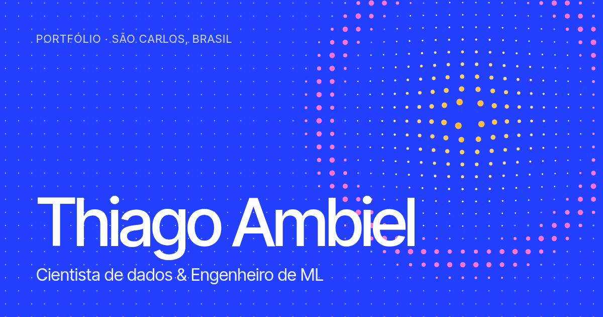

### Olá! Sou o Thiago 👋

Cientista de dados e engenheiro de ML em São Carlos, formado em Ciência de Dados no ICMC-USP, com iniciação científica FAPESP. Trabalho com busca semântica, visão computacional e modelos generativos, e gosto de levar pesquisa até quem vai usar.

**[thiagoambiel.com.br](https://thiagoambiel.com.br)** · **[Google Scholar](https://scholar.google.com/citations?user=Bhxkr94AAAAJ)** · **[ORCID](https://orcid.org/0000-0002-4421-4399)**

---

### Projetos

| Projeto | O que é | Fontes |
|---|---|---|
| **[Sonar Municipal](https://sonar-municipal.vercel.app)** NLP · 2025–26 | Busca em linguagem natural sobre 220 mil projetos de lei de 322 municípios. Um PTT5 ajustado reescreve cada ementa como uma ação curta. nDCG@10 de 0,704, contra 0,536 do BM25. | [Site](https://sonar-municipal.vercel.app) · [Código](https://github.com/thiagoambiel/SonarMunicipal) · [Modelo](https://huggingface.co/thiagoambiel/sonar_municipal_ptt5_ementa2action) · DOIs: [pipeline](https://doi.org/10.5281/zenodo.20518536), [benchmark](https://doi.org/10.5281/zenodo.20564284), [modelo](https://doi.org/10.5281/zenodo.20564327) |
| **[Portrait Stylization](https://github.com/thiagoambiel/PortraitStylization)** Visão · 2021–23 | Transferência de estilo para retratos com perdas de identidade facial (FaceNet) e de malha facial (FaceMesh). | [Artigo (arXiv)](https://arxiv.org/abs/2309.13492) · [Código](https://github.com/thiagoambiel/PortraitStylization) · [Colab](https://colab.research.google.com/github/thiagoambiel/PortraitStylization/blob/colab/notebooks/PortraitStylization_Demo.ipynb) |
| **SVA-VAE** Generativos · 2024–26 | Iniciação científica FAPESP. Um autoencoder que codifica imagem e máscara num único latente para gerar dados sintéticos de segmentação médica. | [Artigo base (LiteVAE)](https://arxiv.org/abs/2405.14477) · código privado |
| **[Neural Atlases](https://github.com/thiagoambiel/NeuralAtlases)** Visão · 2022 | Edição de vídeo consistente com atlas neurais em camadas, com recursos que a implementação oficial não tem. | [Código](https://github.com/thiagoambiel/NeuralAtlases) · [Artigo original](https://arxiv.org/abs/2109.11418) |
| **k-Influential Nodes** Grafos · 2023 | Redes de influência entre ações para montar carteiras de investimento, testadas em 6 índices de mercado. | [Artigo (IEEE ICDMW 2023)](https://doi.org/10.1109/ICDMW60847.2023.00066) |
| **[Simulador ICMC](https://thiagoambiel.github.io/SimuladorICMC/)** Ferramentas | Simulador do processador didático do ICMC que roda direto no navegador. | [Demo](https://thiagoambiel.github.io/SimuladorICMC/) · [Código](https://github.com/thiagoambiel/SimuladorICMC) |

### Na imprensa

- **Jornal da USP**, 12 mar 2026: [Aluno da USP cria plataforma que identifica políticas públicas eficazes em municípios brasileiros](https://jornal.usp.br/universidade/aluno-da-usp-cria-plataforma-que-identifica-politicas-publicas-eficazes-em-municipios-brasileiros/)
- **Agência FAPESP**, 10 abr 2026: [matéria sobre o Sonar Municipal](https://agencia.fapesp.br/57709)
- **Rádio USP**, 29 abr 2026: [entrevista em vídeo](https://www.instagram.com/reels/DWYxEyzDnJo/)

### Ferramentas

`Python` · `PyTorch` · `Hugging Face` · `Qdrant` · `Weights & Biases` · `Next.js` · `JavaScript`

---

Este repositório também é o código do meu portfólio: o site fica em <a href="site/"><code>site/</code></a> e é publicado na Vercel (veja <a href="docs/DEPLOY.md"><code>docs/DEPLOY.md</code></a>).
